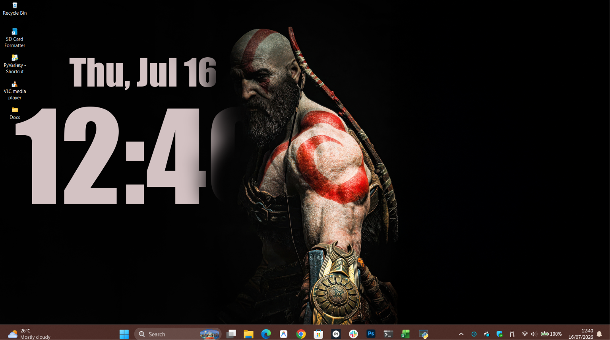
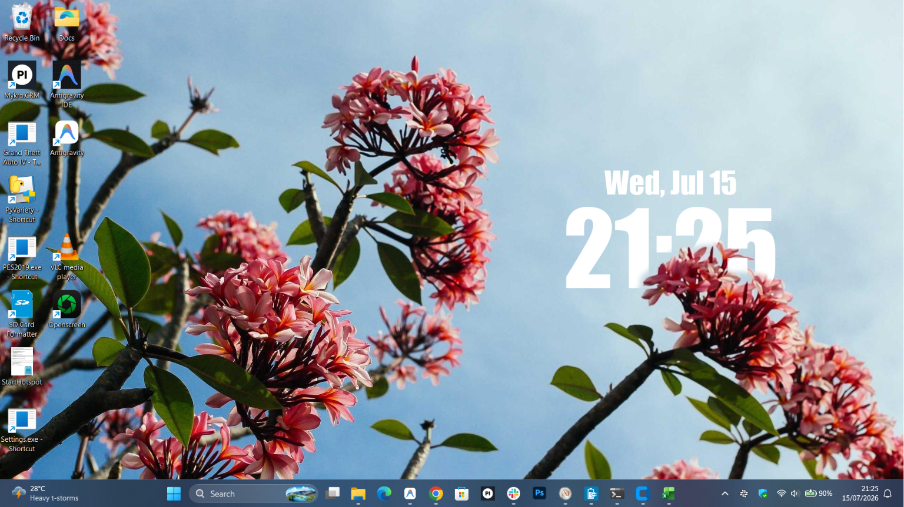
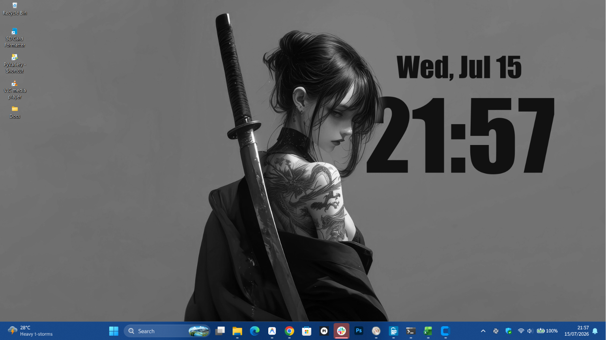
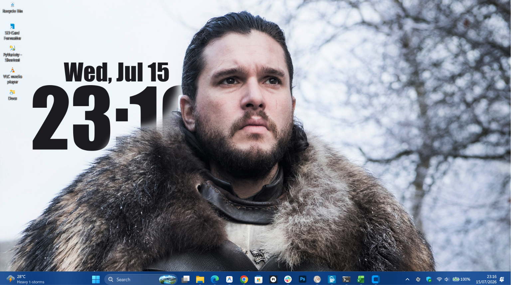
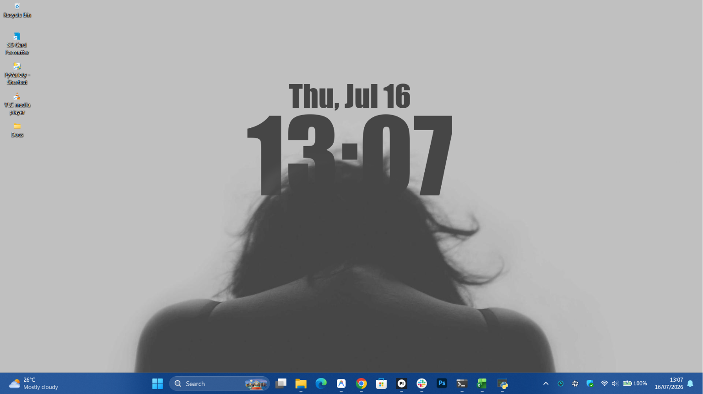
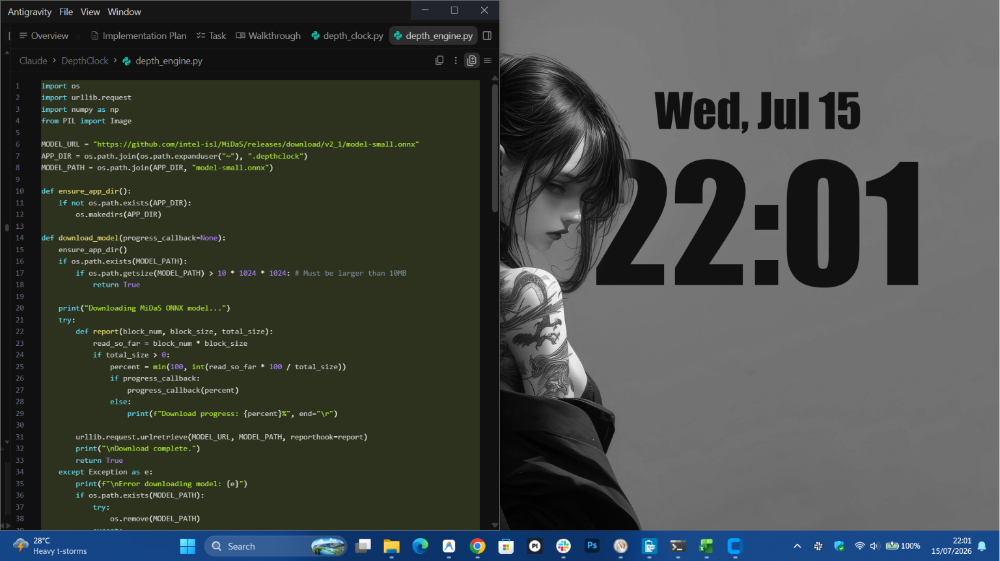

# ⏰ Depth Clock for Windows

<p align="center">
  
</p>

<p align="center">
  <b>Bring iOS 16-style Depth Effect Lockscreen & Desktop Wallpapers to Windows 10 & 11.</b><br>
  Powered by AI Computer Vision (ONNX) to seamlessly place clock and date layers behind foreground subjects.
</p>

<p align="center">
  
  
  
  
</p>

---

## ✨ Features

- 🌊 **AI Depth Estimation & Subject Segmentation**:
  - **MiDaS Small (ONNX)**: Smooth relative depth estimation for landscapes and continuous horizons.
  - **U-2-Netp (4.7MB)**: Fast, ultra-lightweight salient subject segmentation.
  - **U-2-Net Full (176MB)**: High-resolution salient object detection for crisp subject outlines.
- 🎨 **Adaptive Color Extraction**: Automatically samples dominant colors from your wallpaper to style the clock.
- 🖱️ **Interactive Positioning**: Direct click-and-drag positioning on the real-time 3D preview canvas.
- 🖼️ **History Gallery**: Fast local caching system to switch between past wallpapers and their precomputed depth maps with zero wait time.
- 💾 **Standalone Wallpaper Export**: Save your layered compositions as high-resolution images without the clock text overlay.
- 📦 **Import & Export Packages (`.depthpkg`)**: Share ready-to-use depth wallpaper presets with friends.
- ⚡ **Lightweight Background Daemon**:
  - Native Windows desktop integration using `WorkerW` behind desktop icons.
  - In-memory bitmap caching so the daemon uses virtually 0% CPU on idle.
  - Automatic pause when fullscreen applications or games are active.
  - Silent lockscreen synchronization.

---

## 📸 Showcase

### Dynamic Subject Layering

<table align="center">
  <tr>
    <td width="50%" align="center">
      <br>
      <b>Floral & Foreground Subject Blend</b>
    </td>
    <td width="50%" align="center">
      <br>
      <b>Subject Cutout & Contrast Layering</b>
    </td>
  </tr>
  <tr>
    <td width="50%" align="center">
      <br>
      <b>Portrait Character Occlusion</b>
    </td>
    <td width="50%" align="center">
      <br>
      <b>Minimalist Silhouette Depth Blend</b>
    </td>
  </tr>
</table>

### Live Desktop Experience
<p align="center">
  
</p>

---

## 🚀 Getting Started

### Option 1: Standalone Portable App (No Python Needed)
1. Navigate to [`dist/DepthClock/`](dist/DepthClock/).
2. Run **`DepthClock.exe`**.
3. Choose your wallpaper, configure your font, size, and depth layer, and click **Apply Wallpaper**.

### Option 2: Run from Source
1. **Clone the repository:**
   ```bash
   git clone https://github.com/Whinh0sa/depth-clock.git
   cd depth-clock
   ```

2. **Install dependencies:**
   ```bash
   pip install -r requirements.txt
   ```

3. **Launch the Configuration Panel:**
   ```bash
   python depth_clock.py
   ```

4. *(Optional)* Launch only the background daemon:
   ```bash
   python depth_clock.py --daemon
   ```

---

## ⚙️ Configuration & Controls

| Control | Description |
| :--- | :--- |
| **Outline Cutout Mode** | Switch between MiDaS (gradient depth) or U-2-Net (sharp subject cutouts). |
| **Foreground Threshold** | Controls how deep the clock sits behind the foreground object. |
| **Edge Softness (Blur)** | Smooths out transitions around subject boundaries. |
| **Auto Color Matching** | Automatically picks the best matching accent color from the wallpaper. |
| **Drag & Drop Position** | Click anywhere on the 3D Preview screen to place your clock. |
| **Export/Import Pkg** | Bundle your wallpaper and depth data into `.depthpkg` files to share. |
| **Save Image** | Exports the rendered wallpaper with the subject mask cutout (clock-free). |

---

## 🔒 Security & Performance Highlights

- **PowerShell Safe**: Uses `-EncodedCommand` (UTF-16LE Base64) with single-quote escaping for lockscreen sync to prevent command injection.
- **Model Verification**: Validates SHA-256 integrity hashes on all downloaded ONNX models to prevent tampering.
- **Resource Efficient**: The background renderer caches image transformations in memory, updating only on clock ticks and pausing during fullscreen games/video playback.

---

## 🛠️ Tech Stack

- **GUI Framework**: CustomTkinter / Tkinter (Per-Monitor DPI Aware)
- **Computer Vision & Inference**: ONNX Runtime, NumPy, Pillow
- **Windows Integration**: `pywin32` (`win32gui`, `win32api`, `win32con`), `pystray` (System Tray)

---

## 📄 License

This project is licensed under the [MIT License](LICENSE).
